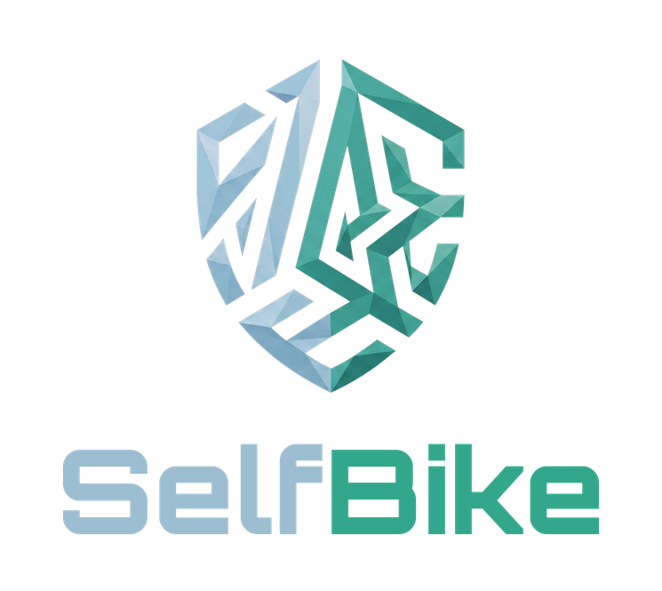

<div align="center">



**Read out your Bosch Smart System e-bike in the browser and change a few settings safely — WebUSB, no install, no account.**<br>
*Dein Bosch-Smart-System-E-Bike im Browser auslesen und sicher einstellen — WebUSB, ohne Installation, ohne Konto.*


[](https://bike.selfcoder.de)
[](LICENSE)


[](https://ko-fi.com/s3lfcod3r)

**[🇬🇧 English](#-english) · [🇩🇪 Deutsch](#-deutsch)**

📰 **What's new / Neuigkeiten** → [CHANGELOG.md](CHANGELOG.md)

</div>

---

<a id="-english"></a>

## 🇬🇧 English

SelfBike reads your **own Bosch Smart System e-bike** over USB and lets you change a handful of settings safely — directly in the browser. No install, no server, no account: everything runs locally on your PC. Live at **[bike.selfcoder.de](https://bike.selfcoder.de)** (Chrome or Edge on a PC).

Part of the **Self** family (SelfMailer, SelfStream, SelfStorm, SelfPoolTracker …) — same design system; deployed as a static site on GitHub Pages.

> **TL;DR** — motor · battery health · charge cycles · fault memory · ride stats · safe settings with backup & read-back · PDF report · demo mode · 12 languages · no install

> **⚠️ Unofficial project:** SelfBike has no connection to Robert Bosch GmbH or any bike manufacturer. Use at your own risk — changes to e-bike electronics can affect warranty and road safety.

### 📑 Table of contents

[Features](#en-features) · [Not included](#en-not-included) · [Usage](#en-usage) · [Architecture](#en-architecture) · [Quick start](#en-quick-start) · [Security](#en-security) · [Tech stack](#en-tech-stack) · [Development](#en-development) · [Roadmap](#en-roadmap) · [Support](#en-support)

<a id="en-features"></a>

### ✨ Features

**🔍 Read out**
- **Overview** — motor, battery, display/remote, ABS, eShift, odometer
- **Battery** — state of charge, health, charge cycles, battery check with rules of thumb, range estimate
- **Ride data** — ride statistics, distance and energy per assist mode, history over time (stored in your browser)
- **Fault memory** — read only; every code gets SelfBike's own area and a general tip (e.g. "Battery – temperature")

**⚙️ Change (only what the manufacturer allows)**
- Light, service interval, start mode, display language, units, clock, walk assist on/off
- **Power ports (beta)** — low/high power port on/off, only where the manufacturer allows it; locked ports are shown, never written
- **Assist modes** — support, dynamics and top speed, only within the limits the bike reports for that mode, **never above 25 km/h**

**💾 Data & reports**
- **Backup before every change** — as a JSON file plus a copy in the browser (last 20); restore at any time
- **Compare** two states (backup or data export)
- **PDF report** in light or dark, in the chosen language — via "Print → Save as PDF", no extra library
- **Wear diary** for parts and maintenance

**🌍 Platform**
- **Demo mode** without a bike — the whole app incl. changes with read-back, answered from demo data
- **12 languages** (de, en, cs, da, es, fi, fr, it, nl, pl, pt, sv)

<a id="en-not-included"></a>

### 🚫 Not included — on purpose

Tuning · changing the speed limit or region · clearing faults · bypassing licences or dealer approvals.

<a id="en-usage"></a>

### 🚲 Usage

1. Switch the e-bike on, connect a USB **data** cable to the display/remote and the PC.
2. Close the Bosch software and any other SelfBike tabs.
3. Open the page, confirm the notice, click **Connect** and select the device.

No bike at hand? Click **"View demo without bike"**.

<a id="en-architecture"></a>

### 🧭 Architecture

```text
Browser (bike.selfcoder.de, Chrome/Edge)
┌─────────────────────────────────────────────────────────────┐
│ index.html         UI: overview · battery · ride · faults … │
│ lib/bike-writer.js plan (before → after), write, read back  │
│ lib/bike-reader.js data points + safety guard (#guard)      │
│ lib/messagebus.js  Smart System MessageBus: build / decode  │
│ lib/mcsp-usb.js    WebUSB transport (MCSP over bulk EPs)    │
│ lib/demo-usb.js    same interface, answers from demo data   │
└──────────────────────────────┬──────────────────────────────┘
                               │ WebUSB
                               ▼
        Display / remote (e.g. Kiox 400C, BRC3200) → e-bike
```

Every write goes through **one** guard right before sending: reads are allowed for any address, writes only for the addresses and payloads in `WRITE_RULES`.

<a id="en-quick-start"></a>

### 🚀 Quick start

Open **[bike.selfcoder.de](https://bike.selfcoder.de)** in Chrome or Edge → connect → done.

To run it yourself: plain HTML/JS, no build — WebUSB needs `localhost` or HTTPS, so serve the folder:

```powershell
.\start-server.ps1
```

Open `http://localhost:8080` → SelfBike runs locally. Any other static server works too (e.g. `python -m http.server 8080`).

<a id="en-security"></a>

### 🛡️ Security

- **Backup first** — before every change a full read-out is saved
- **Preview** — you see every value before → after and confirm it
- **Step by step with read-back** — before each step: same bike, value unchanged since the backup; after each step the value is read back, any mismatch aborts
- **Never retried automatically**; an interrupted change is remembered
- **Manufacturer approval** — only values the bike reports as changeable
- **Hard limits** — assist speed never above 25 km/h, no region / speed-limit writes, fault memory read only
- **No server, no account** — data stays in your browser (`localStorage` / IndexedDB); serial numbers are shortened in exports
- Bosch fault texts are **not shipped** — SelfBike shows its own classification (area + general tip) instead

Security update history → [CHANGELOG.md](CHANGELOG.md) (entries marked 🔒).

<a id="en-tech-stack"></a>

### 🧱 Tech stack

| Part | Tech |
|---|---|
| Web | Plain HTML · CSS · JavaScript modules (no build) · Self brand tokens · Orbitron (self-hosted) |
| Bike | WebUSB · MCSP transport · Bosch Smart System MessageBus (protobuf-style fields) |
| Storage | `localStorage` · IndexedDB · JSON backups |
| Report | Print-ready HTML → PDF via the browser |
| Deploy | GitHub Pages (`bike.selfcoder.de`) |

<a id="en-development"></a>

### 🛠️ Development

No build step, no dependencies — edit the files and reload. Start the local server (WebUSB needs `localhost` or HTTPS):

```powershell
.\start-server.ps1
```

- `index.html` — the app; logic lives in `lib/` (ES modules)
- `data/fault-texts.csv` — own fault-code texts (`code;lang;title;hint`), loaded automatically; write them yourself, never copy Bosch texts
- `lib/i18n/<lang>*.js` — translations, German is the source; missing keys fall back to German
- `bike-read.html`, `bike-write.html`, `usb-check.html` — simple expert/test pages for reading, writing and checking the USB connection
- Without a bike: demo mode (`lib/demo-usb.js` + `lib/demo-data.js`) runs the full app including the safety guard

<a id="en-roadmap"></a>

### 🗺️ Roadmap

- [x] Read out motor, battery, display, ABS, eShift and ride data over WebUSB
- [x] Safe changes with backup, preview, step-by-step read-back
- [x] Assist modes within the bike's limits (max. 25 km/h)
- [x] Fault memory, PDF report, history, compare, demo mode, 12 languages
- [ ] Next steps — tell me what you'd like to see via [Issues](https://github.com/s3lfcod3r/SelfBike/issues)

Trademarks belong to their owners and are only named to describe compatibility.

<a id="en-support"></a>

### ☕ Support

SelfBike is free and without ads. If it helps you and you'd like to support further development:

[☕ Support SelfBike on Ko-fi](https://ko-fi.com/s3lfcod3r)

<p align="right"><a href="#-english">⬆ back to top</a></p>

---

<a id="-deutsch"></a>

## 🇩🇪 Deutsch

SelfBike liest dein **eigenes Bosch-Smart-System-E-Bike** per USB aus und ändert wenige Einstellungen sicher — direkt im Browser. Ohne Installation, ohne Server, ohne Konto: Alles läuft lokal auf deinem PC. Live unter **[bike.selfcoder.de](https://bike.selfcoder.de)** (Chrome oder Edge am PC).

Teil der **Self**-Familie (SelfMailer, SelfStream, SelfStorm, SelfPoolTracker …) — gleiches Design-System; läuft als statische Seite auf GitHub Pages.

> **Kurz** — Motor · Akku-Gesundheit · Ladezyklen · Fehlerspeicher · Fahrstatistik · sichere Einstellungen mit Backup und Rücklesen · PDF-Bericht · Demo-Modus · 12 Sprachen · keine Installation

> **⚠️ Inoffizielles Projekt:** SelfBike hat keine Verbindung zur Robert Bosch GmbH oder zu Fahrradherstellern. Nutzung auf eigene Gefahr — Änderungen an der E-Bike-Elektronik können Garantie und Verkehrssicherheit betreffen.

### 📑 Inhaltsverzeichnis

[Funktionen](#de-funktionen) · [Nicht enthalten](#de-nicht-enthalten) · [Benutzung](#de-benutzung) · [Architektur](#de-architektur) · [Schnellstart](#de-schnellstart) · [Sicherheit](#de-sicherheit) · [Tech-Stack](#de-tech-stack) · [Entwicklung](#de-entwicklung) · [Roadmap](#de-roadmap) · [Unterstützen](#de-unterstuetzen)

<a id="de-funktionen"></a>

### ✨ Funktionen

**🔍 Auslesen**
- **Übersicht** — Motor, Akku, Bedieneinheit, ABS, eShift, Kilometer
- **Akku** — Ladezustand, Gesundheit, Ladezyklen, Akku-Check mit Faustregeln, Reichweiten-Schätzung
- **Fahrdaten** — Fahrstatistik, Strecke und Energie je Fahrmodus, Verlauf über die Zeit (im Browser gespeichert)
- **Fehlerspeicher** — nur lesen; jeder Code bekommt eine eigene Einordnung mit Bereich und allgemeinem Hinweis (z. B. „Akku – Temperatur“)

**⚙️ Ändern (nur was der Hersteller freigibt)**
- Licht, Service-Intervall, Startmodus, Display-Sprache, Einheiten, Uhrzeit, Schiebehilfe an/aus
- **Power Ports (Beta)** — Low/High Power Port an/aus, nur wenn der Hersteller es freigibt; gesperrte Ports werden nur angezeigt, nie geschrieben
- **Fahrmodi** — Unterstützung, Dynamik und Höchstgeschwindigkeit, nur innerhalb der Grenzen, die das Fahrrad für den Modus meldet, **nie über 25 km/h**

**💾 Daten & Berichte**
- **Backup vor jeder Änderung** — als JSON-Datei plus Kopie im Browser (letzte 20); jederzeit wiederherstellbar
- **Vergleichen** zweier Stände (Backup oder Daten-Export)
- **PDF-Bericht** hell oder dunkel, in der gewählten Sprache — über „Drucken → Als PDF speichern“, ohne Zusatzbibliothek
- **Verschleiß-Tagebuch** für Teile und Wartung

**🌍 Plattform**
- **Demo-Modus** ohne Fahrrad — die ganze App inkl. Änderungen mit Rücklesen, beantwortet aus Demo-Daten
- **12 Sprachen** (de, en, cs, da, es, fi, fr, it, nl, pl, pt, sv)

<a id="de-nicht-enthalten"></a>

### 🚫 Bewusst nicht enthalten

Tuning · Änderungen an Tempolimit oder Region · Fehler löschen · Umgehen von Lizenzen oder Händlerfreigaben.

<a id="de-benutzung"></a>

### 🚲 Benutzung

1. E-Bike einschalten, USB-**Daten**kabel an die Bedieneinheit und den PC.
2. Bosch-Software und andere SelfBike-Tabs schließen.
3. Seite öffnen, Hinweis bestätigen, **Verbinden** und das Gerät auswählen.

Kein Fahrrad zur Hand? **„Demo ohne Fahrrad ansehen“** klicken.

<a id="de-architektur"></a>

### 🧭 Architektur

```text
Browser (bike.selfcoder.de, Chrome/Edge)
┌─────────────────────────────────────────────────────────────┐
│ index.html         Oberfläche: Übersicht · Akku · Fahrdaten │
│ lib/bike-writer.js planen (vorher → nachher), schreiben,    │
│                    zurücklesen                              │
│ lib/bike-reader.js Datenpunkte + Sicherheits-Guard (#guard) │
│ lib/messagebus.js  Smart-System-MessageBus: bauen/zerlegen  │
│ lib/mcsp-usb.js    WebUSB-Transport (MCSP über Bulk-EPs)    │
│ lib/demo-usb.js    gleiche Schnittstelle, Demo-Antworten    │
└──────────────────────────────┬──────────────────────────────┘
                               │ WebUSB
                               ▼
      Bedieneinheit (z. B. Kiox 400C, BRC3200) → E-Bike
```

Jedes Schreiben läuft durch **eine** Prüfstelle direkt vor dem Senden: Lesen ist für jede Adresse erlaubt, Schreiben nur für die Adressen und Nutzlasten in `WRITE_RULES`.

<a id="de-schnellstart"></a>

### 🚀 Schnellstart

**[bike.selfcoder.de](https://bike.selfcoder.de)** in Chrome oder Edge öffnen → verbinden → fertig.

Selbst betreiben: reines HTML/JS, kein Build — WebUSB braucht `localhost` oder HTTPS, also den Ordner ausliefern:

```powershell
.\start-server.ps1
```

`http://localhost:8080` öffnen → SelfBike läuft lokal. Jeder andere statische Webserver geht auch (z. B. `python -m http.server 8080`).

<a id="de-sicherheit"></a>

### 🛡️ Sicherheit

- **Erst Backup** — vor jeder Änderung wird der komplette Lesestand gesichert
- **Vorschau** — du siehst jeden Wert vorher → nachher und bestätigst ihn
- **Schritt für Schritt mit Rücklesen** — vor jedem Schritt: gleiches Fahrrad, Wert unverändert seit dem Backup; nach jedem Schritt wird zurückgelesen, bei Abweichung Abbruch
- **Nie automatisch wiederholt**; eine unterbrochene Änderung wird gemerkt
- **Herstellerfreigabe** — nur Werte, die das Fahrrad als „änderbar“ meldet
- **Harte Grenzen** — Unterstützung nie über 25 km/h, kein Schreiben von Region/Tempolimit, Fehlerspeicher nur lesen
- **Kein Server, kein Konto** — Daten bleiben in deinem Browser (`localStorage` / IndexedDB); Seriennummern werden beim Export gekürzt
- Bosch-Fehlertexte werden **nicht mitgeliefert** — SelfBike zeigt stattdessen eine eigene Einordnung (Bereich + allgemeiner Hinweis)

Verlauf der Sicherheitsupdates → [CHANGELOG.md](CHANGELOG.md) (Einträge mit 🔒).

<a id="de-tech-stack"></a>

### 🧱 Tech-Stack

| Teil | Technik |
|---|---|
| Web | Reines HTML · CSS · JavaScript-Module (kein Build) · Self-Marken-Tokens · Orbitron (selbst gehostet) |
| Fahrrad | WebUSB · MCSP-Transport · Bosch-Smart-System-MessageBus (Protobuf-artige Felder) |
| Speicher | `localStorage` · IndexedDB · JSON-Backups |
| Bericht | Druckfertiges HTML → PDF über den Browser |
| Deploy | GitHub Pages (`bike.selfcoder.de`) |

<a id="de-entwicklung"></a>

### 🛠️ Entwicklung

Kein Build, keine Abhängigkeiten — Dateien ändern und neu laden. Lokalen Server starten (WebUSB braucht `localhost` oder HTTPS):

```powershell
.\start-server.ps1
```

- `index.html` — die App; die Logik liegt in `lib/` (ES-Module)
- `data/fault-texts.csv` — eigene Fehlertexte (`code;lang;title;hint`), werden automatisch geladen; selbst formulieren, keine Bosch-Texte kopieren
- `lib/i18n/<sprache>*.js` — Übersetzungen, Deutsch ist die Quelle; fehlende Texte fallen auf Deutsch zurück
- `bike-read.html`, `bike-write.html`, `usb-check.html` — einfache Experten-/Testseiten zum Lesen, Schreiben und Prüfen der USB-Verbindung
- Ohne Fahrrad: Demo-Modus (`lib/demo-usb.js` + `lib/demo-data.js`) fährt die ganze App samt Sicherheits-Guard

<a id="de-roadmap"></a>

### 🗺️ Roadmap

- [x] Motor, Akku, Bedieneinheit, ABS, eShift und Fahrdaten per WebUSB auslesen
- [x] Sichere Änderungen mit Backup, Vorschau und Rücklesen Schritt für Schritt
- [x] Fahrmodi innerhalb der Grenzen des Fahrrads (max. 25 km/h)
- [x] Fehlerspeicher, PDF-Bericht, Verlauf, Vergleich, Demo-Modus, 12 Sprachen
- [ ] Nächste Schritte — Wünsche gern über [Issues](https://github.com/s3lfcod3r/SelfBike/issues)

Marken gehören ihren Inhabern und werden nur genannt, um die Kompatibilität zu beschreiben.

<a id="de-unterstuetzen"></a>

### ☕ Unterstützen

SelfBike ist kostenlos und ohne Werbung. Wenn es dir hilft und du die Weiterentwicklung unterstützen möchtest:

[☕ SelfBike auf Ko-fi unterstützen](https://ko-fi.com/s3lfcod3r)

<p align="right"><a href="#-deutsch">⬆ nach oben</a></p>

---

## ☕ Support / Unterstützen

**🇬🇧** SelfBike is free, without ads, and built in my spare time. If it helps you, a coffee keeps the next update coming. No pressure, a ⭐ on the repo helps too!

**🇩🇪** SelfBike ist kostenlos, ohne Werbung und entsteht in meiner Freizeit. Wenn es dir hilft, hält ein Kaffee das nächste Update am Laufen. Kein Muss, ein ⭐ auf dem Repo hilft auch!

<a href="https://ko-fi.com/s3lfcod3r"></a>

---

## ⚖️ Lizenz / License

**🇩🇪 Alle Rechte vorbehalten.** © 2026 s3lfcod3r / SelfCoder

Du darfst die Software **privat und nicht-kommerziell** benutzen.

**Ohne schriftliche Erlaubnis verboten:** kommerzielle Nutzung · Kopieren · Verändern · Weitergeben · Einbauen in eigene Projekte (auch Closed Source) · Verkaufen.

Komponenten Dritter (siehe [data/ATTRIBUTION.md](data/ATTRIBUTION.md)) bleiben unter ihren eigenen Lizenzen.

Details: [LICENSE](LICENSE)

**🇬🇧 All rights reserved.** © 2026 s3lfcod3r / SelfCoder

You may use the software **privately and non-commercially**.

**Not permitted without written permission:** commercial use · copying · modifying · redistributing · incorporating into other projects (including closed source) · selling.

Third-party components (see [data/ATTRIBUTION.md](data/ATTRIBUTION.md)) remain under their own licenses.

Details: [LICENSE](LICENSE)

---

<div align="center">

**SelfBike** · part of the Self family · Teil der Self-Familie<br>
made with 🚲 for riders who like to look under the hood

</div>
